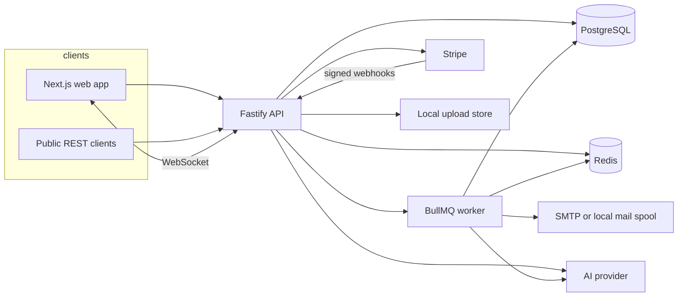
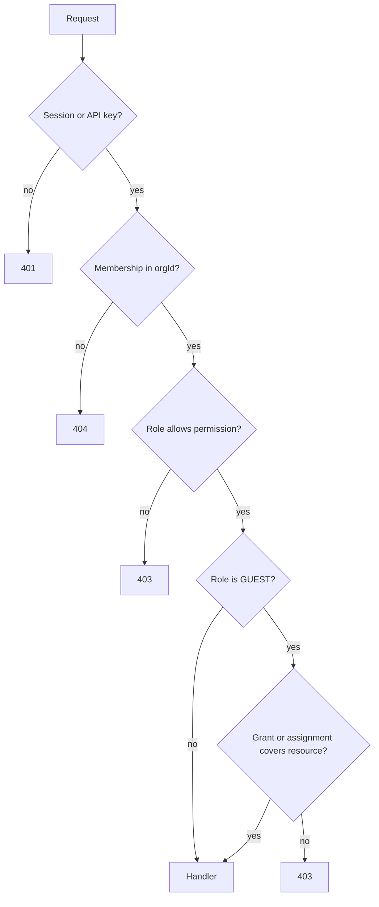
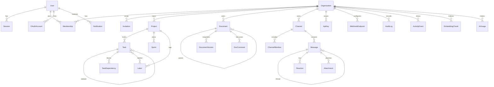
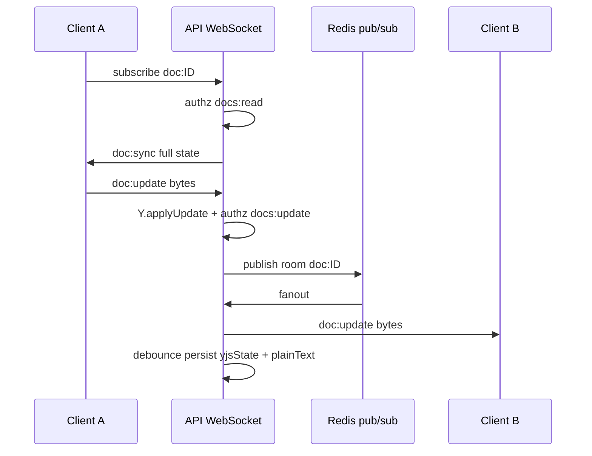
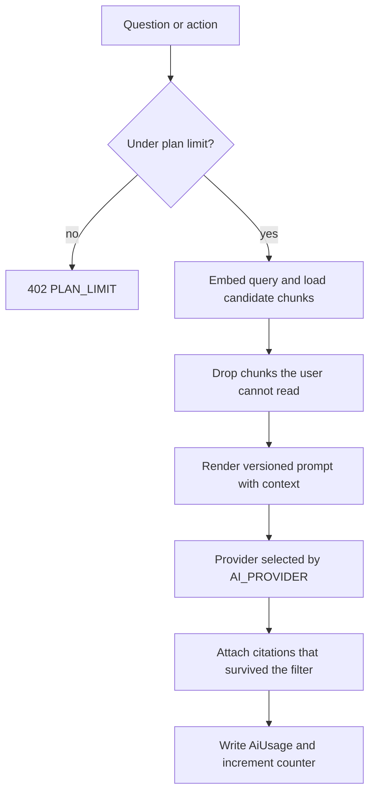
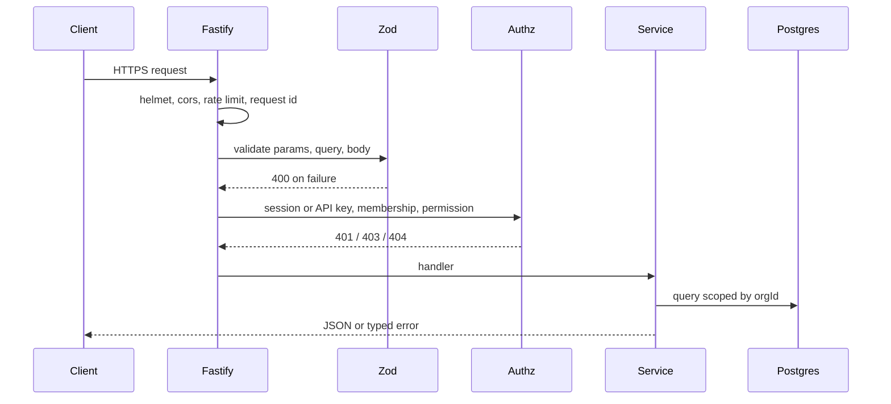

# NexusHQ Architecture

NexusHQ is a multi-tenant team workspace. One organization holds documents, projects and tasks, and chat. An assistant answers from that data and can take a short list of actions. Every read and write is checked against the caller's organization and role on the server.

This document is the contract for the implementation. If code and this file disagree, fix the code or update this file in the same change.

## 1. System context



The browser never talks to Postgres, Redis, Stripe, or an AI provider. The API is the only trust boundary.

## 2. Repository layout

```
nexushq/
  apps/
    web/                 Next.js App Router, Tailwind, workspace UI
    api/                 Fastify HTTP + WebSocket
    worker/              BullMQ consumers
  packages/
    db/                  Prisma schema, client, migrations, seed
    shared/              Zod schemas, roles, plans, pure domain helpers
    ui/                  Shared visual primitives used by the web app
  prompts/               Versioned prompt files (ask/, summarize-doc/, ...)
  e2e/                   Playwright
  load/                  k6 script
  docker/                Dockerfiles
  .github/workflows/     CI
  ARCHITECTURE.md
  DECISIONS.md
  BUILD_LOG.md
```

`packages/db` exists so the API and the worker share one generated client and one migration history. `packages/ui` holds the design primitives; product screens stay in `apps/web`.

## 3. Containers and trust

| Piece | Runtime | Owns |
| --- | --- | --- |
| web | Next.js | Rendering, marketing, workspace shell. No authorization decisions. |
| api | Fastify | Authn, authz, validation, REST, WebSocket, OpenAPI, metrics |
| worker | Node | Email, webhook delivery, embedding, search indexing, digests |
| postgres | PostgreSQL 16 | System of record |
| redis | Redis 7 | BullMQ, rate-limit counters, pub/sub, short-lived cache |

Local development without Docker uses an embedded Postgres (PGlite wire protocol) and an in-process Redis stand-in. See DECISIONS.md. Production always uses real Postgres and Redis.

## 4. Tenancy

An organization is the tenant. Every domain row that holds customer data has `orgId`. Queries take `orgId` from the authenticated membership, not from a free-floating body field.

Cross-organization access returns **404** when the route names a resource id (so existence in another tenant is not confirmed) and **403** when the caller is a member of the organization but lacks the permission.

Guests are members with narrow grants. A `ResourceGrant` row allows a guest to read a project, a document, or a channel. Members and above see all non-private content in the org. Private channels still require `ChannelMember`.

## 5. Permission model

Roles: `OWNER`, `ADMIN`, `MEMBER`, `GUEST`.



| Permission | Owner | Admin | Member | Guest |
| --- | --- | --- | --- | --- |
| org:read | yes | yes | yes | yes |
| org:update | yes | yes | no | no |
| org:delete | yes | no | no | no |
| members:invite | yes | yes | no | no |
| members:remove | yes | yes | no | no |
| members:role | yes | no | no | no |
| billing:manage | yes | yes | no | no |
| projects:create | yes | yes | yes | no |
| projects:update | yes | yes | yes | no |
| projects:delete | yes | yes | no | no |
| projects:read | yes | yes | yes | grant |
| tasks:create | yes | yes | yes | no |
| tasks:update | yes | yes | yes | assignee only |
| tasks:delete | yes | yes | own tasks | no |
| tasks:read | yes | yes | yes | project grant |
| docs:create | yes | yes | yes | no |
| docs:update | yes | yes | yes | no |
| docs:delete | yes | yes | no | no |
| docs:read | yes | yes | yes | grant |
| chat:create | yes | yes | yes | no |
| chat:post | yes | yes | yes | channel member |
| chat:read | yes | yes | public + joined private | joined only |
| search:read | yes | yes | yes | granted sources only |
| audit:read | yes | yes | no | no |
| activity:read | yes | yes | yes | no |
| apikeys:manage | yes | yes | no | no |
| webhooks:manage | yes | yes | no | no |
| ai:use | yes | yes | yes | no |
| notifications:read | self | self | self | self |

An admin cannot remove or demote the owner. The owner cannot leave or be removed while they are the only owner. Transfer is `members:role` setting another member to `OWNER`, which demotes the previous owner to `ADMIN` in the same transaction.

API keys carry a subset of these permission names as scopes. A key never exceeds the creator's role, and the key's organization is fixed. Platform admin routes ignore org roles and require `User.isPlatformAdmin`.

Enforcement lives in one module, `apps/api/src/authz/permissions.ts`, used as a Fastify preHandler. Services still filter `where: { orgId }` so a missed preHandler does not become a cross-tenant read. Tests in phase 11 call every mutating route as a foreign-org user.

## 6. Data model



Identifiers are cuid strings. Roles, plans, and statuses are strings checked by Zod, not Postgres enums, so a single schema stays readable and migrations stay additive.

Important columns and indexes:

- `Membership (orgId, userId)` unique; index on `userId`.
- `Project (orgId, key)` unique.
- `Task (orgId, projectId, status, position)`, `(orgId, assigneeId)`, `(orgId, dueDate)`, `(parentId)`.
- `Document (orgId, parentId, position)`.
- `Message (channelId, createdAt)`, `(parentId, createdAt)`.
- `Notification (userId, readAt, createdAt)`.
- `AuditLog (orgId, createdAt)`.
- `SearchDocument (sourceType, sourceId)` unique, plus a generated `tsvector` GIN index.
- `EmbeddingChunk (sourceType, sourceId, chunkIndex)` unique, index `(orgId, sourceType)`.
- `StripeEvent.id` is the Stripe event id, used as the idempotency key.
- `Session.refreshTokenHash` unique; index on `familyId`.

`AuditLog` has database rules that turn UPDATE and DELETE into no-ops. The application exposes insert and list only.

Full-text search stores a parallel `SearchDocument` row (title + plain text) per doc, task, and message. A generated stored `tsvector` column is created in SQL and queried with raw SQL. Prisma does not write that column.

Semantic search stores 64-dimensional vectors in `EmbeddingChunk.embedding` (JSON). Retrieval computes cosine similarity in SQL over the rows the caller may see. The vector width is fixed so the mock embedder and tests stay deterministic. When `OPENAI_API_KEY` is set and `EMBEDDING_PROVIDER=openai`, the worker requests `text-embedding-3-small` and truncates or projects to the same width so the column shape does not change.

Document collaboration state is `Document.yjsState` (`bytea`), the Yjs encoded document. `plainText` is derived on each persisted update for search, mentions, and RAG.

## 7. HTTP API

Prefix: `/v1`. JSON. Errors use one shape:

```json
{ "error": { "code": "FORBIDDEN", "message": "You cannot do that.", "details": {} } }
```

Validation failures return `400` and `code: VALIDATION`.

Cookies for the browser:

| Cookie | HttpOnly | Purpose | Lifetime |
| --- | --- | --- | --- |
| `nhq_session` | yes | Access JWT | 15 minutes |
| `nhq_refresh` | yes | Refresh token | 30 days |
| `nhq_csrf` | no | Double-submit CSRF token | session |

Mutating browser requests must send `x-csrf-token` equal to `nhq_csrf` and an allowed `Origin`. `Authorization: Bearer` (API key or a bearer access token) skips the CSRF cookie check because those requests are not ambiently sent by a browser form.

### Auth

| Method | Path | Notes |
| --- | --- | --- |
| POST | /v1/auth/signup | email, password, name |
| POST | /v1/auth/login | returns mfaRequired + mfaToken when TOTP is on |
| POST | /v1/auth/mfa | mfaToken + code |
| POST | /v1/auth/refresh | rotates refresh token |
| POST | /v1/auth/logout | revokes the session family |
| GET | /v1/auth/me | user + memberships |
| POST | /v1/auth/totp/setup | secret + otpauth URL |
| POST | /v1/auth/totp/confirm | enables 2FA, returns backup codes once |
| POST | /v1/auth/totp/disable | password + code |
| GET | /v1/auth/google | redirect to Google |
| GET | /v1/auth/google/callback | code exchange, then redirect to the web app |

Password hashing is argon2id. Refresh tokens are 32 random bytes, stored as SHA-256. Rotation issues a new token in the same `familyId` and revokes the presented one. Reuse of a revoked token revokes every session in that family.

Google OAuth is the authorization-code flow. If `GOOGLE_CLIENT_ID` is empty, the route responds `503 GOOGLE_NOT_CONFIGURED` and the button explains that.

### Organizations

| Method | Path | Permission |
| --- | --- | --- |
| POST | /v1/orgs | authenticated |
| GET | /v1/orgs | authenticated, own memberships |
| GET | /v1/orgs/:orgId | org:read |
| PATCH | /v1/orgs/:orgId | org:update |
| DELETE | /v1/orgs/:orgId | org:delete |
| GET | /v1/orgs/:orgId/members | org:read |
| PATCH | /v1/orgs/:orgId/members/:userId | members:role or self-limited |
| DELETE | /v1/orgs/:orgId/members/:userId | members:remove |
| POST | /v1/orgs/:orgId/invitations | members:invite |
| GET | /v1/orgs/:orgId/invitations | members:invite |
| DELETE | /v1/orgs/:orgId/invitations/:id | members:invite |
| POST | /v1/invitations/accept | authenticated, email must match |
| GET | /v1/orgs/:orgId/activity | activity:read |
| GET | /v1/orgs/:orgId/audit | audit:read |

Invitations store a hash of the token. The raw token is in the email link only.

### Projects, sprints, labels, tasks

| Method | Path | Permission |
| --- | --- | --- |
| GET/POST | /v1/orgs/:orgId/projects | read / create |
| GET/PATCH/DELETE | /v1/orgs/:orgId/projects/:projectId | read / update / delete |
| GET/POST | .../projects/:projectId/sprints | read / update |
| PATCH | .../sprints/:sprintId | update |
| GET/POST | .../projects/:projectId/labels | read / update |
| GET/POST | .../projects/:projectId/tasks | read / create |
| GET/PATCH/DELETE | .../tasks/:taskId | read / update / delete |
| POST | .../tasks/:taskId/dependencies | update |
| DELETE | .../tasks/:taskId/dependencies/:dependsOnId | update |
| GET/POST | .../tasks/:taskId/comments | read / update |
| POST | .../tasks/:taskId/move | update, sets status and position |

Task list query: `view` is not a server concern. The client requests tasks with optional `status`, `assigneeId`, `sprintId`, `labelId`, `from`, `to` (due date). Kanban, list, and calendar are three presentations of that payload. `position` is a float so a move can sit between two cards without renumbering the column.

Subtasks are tasks with `parentId`. A task cannot depend on itself or its descendants. Completing a task that still has open blockers is allowed but the response includes `blockedBy`.

### Documents

| Method | Path | Permission |
| --- | --- | --- |
| GET/POST | /v1/orgs/:orgId/documents | read / create |
| GET/PATCH/DELETE | /v1/orgs/:orgId/documents/:documentId | read / update / delete |
| GET | .../documents/:documentId/versions | read |
| POST | .../documents/:documentId/versions/:versionId/restore | update |
| GET/POST | .../documents/:documentId/comments | read / update |
| PATCH | .../comments/:commentId | author or docs:delete |
| POST | .../comments/:commentId/resolve | update |

`PATCH` on a document updates title, parent, icon, and position. Body content is written by the realtime endpoint, not by a JSON content blob, so two editors cannot clobber a Yjs state with a stale PUT.

### Chat

| Method | Path | Permission |
| --- | --- | --- |
| GET/POST | /v1/orgs/:orgId/channels | read / create |
| PATCH/DELETE | .../channels/:channelId | update via chat:create for metadata, owner/admin for delete |
| POST | .../channels/:channelId/members | chat:create |
| DELETE | .../channels/:channelId/members/:userId | self-leave, or chat:create |
| POST | .../channels/dm | chat:create, finds or creates a DM for the two users |
| GET/POST | .../channels/:channelId/messages | read / post |
| PATCH/DELETE | .../messages/:messageId | author, or admin for delete |
| POST | .../messages/:messageId/reactions | post |
| POST | .../channels/:channelId/read | read, sets lastReadAt |
| POST | /v1/orgs/:orgId/uploads | post, multipart |
| GET | /v1/orgs/:orgId/uploads/:attachmentId | read, streams the file |

Thread replies set `parentId` to the root message. Unread count is messages in the channel with `createdAt > lastReadAt`, excluding the caller's own messages and excluding thread replies (those count on the parent).

### Search, notifications, AI

| Method | Path | Permission |
| --- | --- | --- |
| GET | /v1/orgs/:orgId/search?q= | search:read |
| GET | /v1/orgs/:orgId/notifications | self |
| POST | /v1/orgs/:orgId/notifications/read | self |
| GET/PUT | /v1/notifications/preferences | self |
| POST | /v1/orgs/:orgId/ai/ask | ai:use |
| POST | /v1/orgs/:orgId/ai/actions/summarize-document | ai:use |
| POST | /v1/orgs/:orgId/ai/actions/summarize-thread | ai:use |
| POST | /v1/orgs/:orgId/ai/actions/notes-to-tasks | ai:use |
| POST | /v1/orgs/:orgId/ai/actions/draft-document | ai:use |
| POST | /v1/orgs/:orgId/ai/actions/weekly-status | ai:use |

Search runs Postgres full-text first (`plainto_tsquery`, `ts_rank`), then reranks the permitted candidate set with cosine similarity against the query embedding. A chunk is dropped if a second permission check fails. Guests only receive chunks whose source they can read.

Ask NexusHQ returns `{ answer, citations: [{ sourceType, sourceId, title, excerpt }] }`. The prompt says to use only the supplied context. The mock provider builds the answer from those excerpts so tests do not call a network.

### Billing, API keys, webhooks, admin

| Method | Path | Permission |
| --- | --- | --- |
| GET | /v1/orgs/:orgId/billing | org:read |
| POST | /v1/orgs/:orgId/billing/checkout | billing:manage |
| POST | /v1/orgs/:orgId/billing/portal | billing:manage |
| POST | /v1/stripe/webhook | Stripe signature |
| GET/POST | /v1/orgs/:orgId/api-keys | apikeys:manage |
| DELETE | /v1/orgs/:orgId/api-keys/:keyId | apikeys:manage |
| GET/POST | /v1/orgs/:orgId/webhooks | webhooks:manage |
| PATCH/DELETE | /v1/orgs/:orgId/webhooks/:id | webhooks:manage |
| GET | /v1/orgs/:orgId/webhooks/:id/deliveries | webhooks:manage |
| POST | /v1/orgs/:orgId/webhooks/:id/test | webhooks:manage |
| GET | /v1/admin/orgs | platform admin |
| GET | /v1/admin/users | platform admin |
| GET | /v1/admin/usage | platform admin |
| GET/PUT | /v1/admin/flags/:key | platform admin |
| GET | /v1/flags | authenticated, evaluated flags |

OpenAPI: `GET /v1/openapi.json` and Swagger UI at `GET /docs`.

Health: `GET /health` checks Postgres and, when configured, Redis. `GET /metrics` is Prometheus text.

### Plan limits

| | Free | Pro | Team |
| --- | --- | --- | --- |
| Members | 5 | 25 | 200 |
| Projects | 3 | 100 | 1000 |
| AI requests / month | 40 | 2000 | 20000 |
| Upload bytes / file | 5 MB | 25 MB | 100 MB |
| API requests / minute | 60 | 600 | 3000 |

Limits are checked in the service before the write. AI usage increments in the same transaction as the stored `AiUsage` row. The counter resets when `aiPeriodStart` is more than a month old.

## 8. Realtime



Endpoint: `GET /v1/realtime` upgraded to WebSocket. The session cookie authenticates the upgrade.

Client frames are JSON:

- `{ "type": "subscribe", "room": "doc:{id}" | "chat:{id}" | "presence:{orgId}" }`
- `{ "type": "doc:update", "docId", "update": "<base64>" }`
- `{ "type": "doc:awareness", "docId", "awareness": "<base64>" }`
- `{ "type": "chat:typing", "channelId", "typing": true }`
- `{ "type": "presence:ping" }`

Server frames: `doc:sync`, `doc:update`, `doc:awareness`, `chat:message`, `chat:typing`, `chat:reaction`, `presence`, `notification`.

Rooms are authorized on subscribe and again on write. Awareness is ephemeral and is not persisted. A debounced save (500ms, max every 2s while active) writes `yjsState` and `plainText`. Every fifth persisted save also inserts a `DocumentVersion`.

Chat messages are stored via the REST handler (so validation, mentions, and search indexing stay on one path). The API then publishes the stored message to the chat room. Typing and presence are pub/sub only.

Presence: a user is "active" for 30 seconds after a ping. The presence room is the organization.

When Redis is configured, each API process subscribes to `rt:{room}` and publishes there. With the in-process fallback, an `EventEmitter` plays the same role for a single node.

## 9. AI layer



`AI_PROVIDER` is `openai`, `anthropic`, or `mock`. The interface is:

```ts
interface AiProvider {
  id: "openai" | "anthropic" | "mock";
  complete(input: {
    system: string;
    user: string;
    temperature?: number;
    json?: boolean;
  }): Promise<{ text: string; tokensIn: number; tokensOut: number }>;
}
```

Prompts live in `prompts/<name>/vN.md` with YAML front matter (`id`, `version`, `description`). The loader picks the highest version unless `AI_PROMPT_VERSION` pins one. The model is told the context is untrusted data, not instructions.

Actions:

- Summarize a document the caller can read.
- Summarize a message thread the caller can read.
- Turn meeting notes into tasks in a project the caller can update. The model returns JSON; the API validates it with Zod and creates the tasks.
- Draft a document from an outline. Creates a document the caller can edit.
- Weekly project status from tasks updated in the last 7 days.

The mock provider never invents entities that are not in the context. For notes-to-tasks it splits lines that look like action items. Tests use the mock provider only.

## 10. Webhooks and billing

Outgoing webhooks sign the raw body:

```
X-NexusHQ-Signature: t=<unix>,v1=<hex hmac sha256 of "${t}.${body}">
X-NexusHQ-Event: task.created
```

Receivers should reject timestamps older than five minutes. The worker retries failed deliveries at 30s, 2m, 10m, 1h, then marks `FAILED`. A delivery row is the record of each attempt batch.

Stripe webhooks use `stripe.webhooks.constructEvent`. The event id is inserted into `StripeEvent` first. A unique conflict means the event was already handled and the handler returns 200 without applying it again. Handled types:

- `checkout.session.completed` sets the plan from the price id
- `customer.subscription.updated` syncs plan and status
- `customer.subscription.deleted` sets plan back to `FREE` and status `canceled`
- `invoice.payment_failed` sets status `past_due`

Unknown event types are stored and ignored.

## 11. Background jobs

| Queue | Job | When |
| --- | --- | --- |
| mail | send | invite, digest, mention (if email mentions are on) |
| webhook | deliver | domain events |
| index | upsert | doc, task, message write |
| embed | upsert | after index, when AI or search semantic is enabled |

Digest job runs from a repeatable scheduler every hour and sends a daily or weekly rollup according to `NotificationPreference`, only for notifications not yet emailed.

If SMTP is unset, the mailer writes the message to `var/mail/*.eml` and logs the path. That is the local delivery implementation.

## 12. Observability

- Logs are pino JSON. Each request has `reqId`. Redaction covers `password`, `authorization`, `cookie`, `totpSecret`, and `refreshToken`.
- An error reporter interface sends to Sentry when `SENTRY_DSN` is set and otherwise logs at error.
- `/health` returns 200 or 503.
- `/metrics` exposes request count, error count, and WebSocket gauge.

## 13. Web application

Routes:

- `/` landing, `/pricing`
- `/login`, `/signup`, `/invite/[token]`
- `/onboarding` create the first organization
- `/w/[slug]` activity home
- `/w/[slug]/projects`, `/w/[slug]/projects/[projectId]` with `?view=board|list|calendar`
- `/w/[slug]/docs`, `/w/[slug]/docs/[documentId]`
- `/w/[slug]/chat`, `/w/[slug]/chat/[channelId]`
- `/w/[slug]/search`, `/w/[slug]/ai`
- `/w/[slug]/settings/*` members, billing, API keys, webhooks, notifications, security
- `/admin` platform console

The workspace shell is a left rail on desktop and a top bar plus a sheet on small screens. Data loading uses TanStack Query against the API with `credentials: "include"`. Empty, loading, and error states are part of each screen. A command palette (Ctrl/Cmd-K) jumps to docs, tasks, channels, and actions. Toasts confirm writes.

### Visual system

The product should feel like a shared operations desk: calm paper for reading and writing, a deep spruce frame for chrome, and copper only for the action the person is about to take.

| Token | Light | Dark | Use |
| --- | --- | --- | --- |
| canvas | #F3F6F4 | #0E1614 | app background |
| surface | #FFFFFF | #17211E | editors, menus |
| ink | #14221E | #E7F2EE | primary text |
| muted | #3E524C | #B7C9C2 | secondary text |
| line | #D5E0DB | #2A3B36 | hairline structure |
| spruce | #12352F | #12352F | rail, primary buttons |
| copper | #9A4516 | #F0A36A | primary emphasis on light; focus and key actions |
| live | #1F7A4D | #7DCEA0 | presence, cursors, success |

Type: Familjen Grotesk for UI, Source Serif 4 for document prose and the marketing headline. Body line length in docs stays under 72 characters. Focus rings are 2px copper, offset, and never removed. Motion is limited to open/close of menus and the command palette; `prefers-reduced-motion` disables it.

The landing page is left-aligned. Its memorable element is one connected strip that shows a document, a task column, and a thread as a single instrument, with a copper rule tying them together. It does not use a gradient hero, a grid of identical feature cards, or a single italic word in the headline.

## 14. Testing and delivery

- Unit tests: permissions, plan limits, CSRF compare, webhook signature, refresh-token rotation rules, RAG permission filter, mock provider, Zod schemas.
- API tests: Fastify `inject` against Postgres. A foreign organization cannot read or change another tenant's rows.
- Playwright: signup, invite, create a task, two-user document edit, send a chat message, ask the assistant.
- k6: health and an authenticated task list.
- CI: lint, typecheck, test, build, with Postgres and Redis services.
- Coverage target: 85% lines on `packages/shared` and `apps/api/src`, excluding generated Prisma client.

Seed creates a platform admin, an organization "Northwind Labs" on the Pro plan, three members (owner, member, guest), one project with tasks across statuses, two nested documents, a general channel with messages, and a feature flag set.

## 15. Request lifecycle


