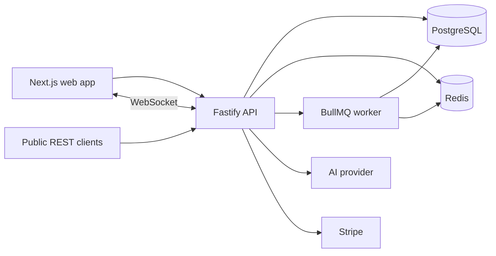

# NexusHQ

**One workspace for a product team's writing, work, and conversation, with an assistant that only knows what you're allowed to see.**

NexusHQ is a multi-tenant team workspace. Teams usually split their work across a document tool, a task tracker, and a chat app. Context gets lost between them, and an assistant sitting outside those tools can't tell what a given person may read. NexusHQ puts documents, projects, and chat in one place and enforces access on the server, so the built-in assistant answers from the same data the signed-in person already has access to.

## What it does

- **Documents.** Nested pages edited together in real time, with comments and version history.
- **Projects and tasks.** Board, list, and calendar views over the same data. Subtasks, dependencies, sprints, labels, and mentions.
- **Chat.** Channels, threads, direct messages, reactions, unread counts, file uploads, typing and presence.
- **Search.** Postgres full-text search, reranked with embeddings, limited to what the caller may read.
- **Assistant.** Ask questions about the workspace and get cited answers. Summarize a page or a thread, turn meeting notes into tasks, draft a page from an outline, or write a weekly status.
- **Hosted-product basics.** Sign-in with two-factor, invitations, plans and Stripe billing, API keys, signed outgoing webhooks, an immutable audit log, and a platform admin console.

## How access works

Access is decided on the API, never in the browser.

- Every organization is a tenant. Every query is scoped by the organization of the caller's membership.
- Four roles: **Owner**, **Admin**, **Member**, **Guest**. A guest only sees projects, pages, and channels they were explicitly granted.
- A request for another tenant's resource returns `404`, so its existence isn't confirmed. A member without permission gets `403`.
- The assistant uses the same rules. It retrieves only chunks the caller can read, then builds the prompt. It has no tool that can query the database on its own.

## How it's built



| Piece | Tech | Role |
| --- | --- | --- |
| `apps/web` | Next.js, Tailwind | Workspace UI, landing and pricing pages |
| `apps/api` | Fastify, Zod | Auth, permissions, REST, WebSocket, OpenAPI, metrics |
| `apps/worker` | BullMQ | Background jobs such as email |
| `packages/db` | Prisma, PostgreSQL 16 | Schema, migrations, seed data |
| `packages/shared` | Zod, TypeScript | Roles, permissions, plan limits, shared schemas |
| `packages/mail` | Nodemailer | SMTP or a local `.eml` spool |
| `packages/ui` | React | Shared UI primitives |
| `prompts/` | Markdown | Versioned assistant prompts |

Notable design choices:

- **Separate API process** instead of Next.js route handlers, so there is one trust boundary to audit.
- **Cookie sessions** for the browser (short-lived access token plus a rotating refresh token with reuse detection), **bearer API keys** for the public API.
- **Yjs** for document bodies, synced over a small JSON WebSocket protocol so the server can authorize every update.
- **Audit log immutability** enforced by the database, not just by application code.
- **AI providers behind one interface** (OpenAI, Anthropic, or a deterministic mock used in tests and local development).

The reasoning for each decision is written down in `DECISIONS.md`.

## Run it locally

You need Node.js 22, pnpm, and Docker.

```bash
docker compose up -d
pnpm install
pnpm db:migrate
pnpm db:seed
pnpm dev
```

The web app runs at http://localhost:3000 and the API at http://localhost:4000. Copy `.env.example` to `.env` first.
## Docs

- `PURPOSE.md`: what the product is for
- `ARCHITECTURE.md`: system design, permission matrix, data model, API surface
- `DECISIONS.md`: design decisions and their reasons
- `DEPLOYMENT.md`: running it in production
- `BUILD_LOG.md`: how the build progressed

## License

Released under the [MIT License](LICENSE).

## Author

Built by [@jainprateek0603](https://github.com/jainprateek0603).
